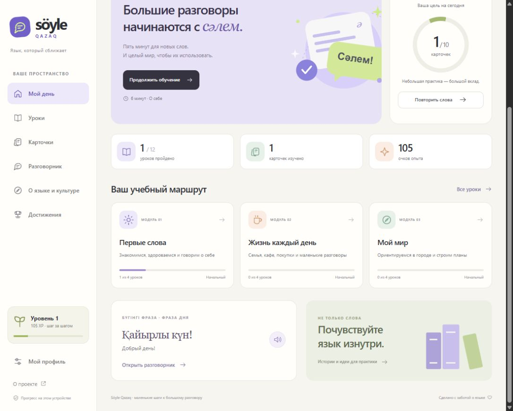

# Söyle Qazaq

**Small steps toward real conversations.** An independent, local-first Kazakh learning application with a Russian interface, an authored beginner curriculum, flashcards, a phrasebook, a reading library, and transparent progress tracking.

No account, paid service, build pipeline, API key, database, or dependency installation is required to try the complete application.



## What you can actually do

| Area | Implemented experience |
| --- | --- |
| My day | A personal learning dashboard, a next-lesson link, daily flashcard goal, real local statistics, phrase of the day, and a learning route |
| Learning | 12 short lessons in 3 modules, 36 worked examples, 48 multiple-choice questions, explanations, review of wrong answers, retries, and best scores |
| Flashcards | 72 Kazakh/Russian cards, recall before revealing, self-rating, scheduled intervals, due-first sessions, and a visible schedule |
| Phrasebook | Instant search in either language, 6 categories, favorites, and speech output when a Kazakh system voice exists |
| Library | 6 original short reading materials, detail pages, vocabulary takeaways, read-state, and links to authoritative external resources |
| Achievements | 8 achievements derived from actual local progress, XP, and a current activity streak |
| Profile | A local display name, daily target, reduced motion, activity history, validated JSON export/import, and confirmed reset |
| About | Scope, privacy, transparent scoring rules, independence disclosure, and an honest roadmap |

The interface is responsive, supports keyboard navigation and reduced motion, and uses custom SVG illustrations. All assets and modules are served from the same directory. The application never creates pretend users, live classrooms, fabricated impact metrics, or a fake leaderboard.

## Run in two commands

Install **Node.js 22 or newer**, then open a terminal in this directory:

```sh
npm start
```

Open **http://127.0.0.1:4173**. On Windows, you can double-click **RUN.cmd** instead. If the browser opens before the server starts, refresh the page once the terminal displays the URL. Close the terminal or press Ctrl+C to stop the server.

```sh
npm test
```

There is no `npm install` step. `npm run check` performs syntax checks. Change the port with the `PORT` environment variable if required:

```powershell
$env:PORT = '4300'
npm start
```

The server binds to loopback only and serves **only `dist/`**. Do not launch `index.html` directly through `file://`: browsers restrict JavaScript module loading there.

## Быстрый старт по-русски

1. Установите Node.js версии 22 или новее.
2. Откройте папку проекта и дважды нажмите **RUN.cmd**, либо выполните `npm start` в PowerShell.
3. Перейдите на **http://127.0.0.1:4173**. Все уроки открыты, регистрация не нужна.
4. В разделе **Уроки** откройте «Сәлем! Давай знакомиться», прочитайте примеры и нажмите «Начать практику».
5. Пройдите 4 вопроса. При 3 правильных ответах получите зачёт и 100 XP. Повторное прохождение не начисляет XP заново.
6. В **Карточках** сначала вспомните перевод, затем откройте ответ и оцените себя.
7. В **Разговорнике** найдите «Рақмет», сохраните фразу и включите фильтр «Избранное».
8. В **Профиле** сохраните имя и экспортируйте прогресс, чтобы иметь резервную копию.

**Прогресс хранится в этом браузере.** Между устройствами он сам не синхронизируется. Очистка данных браузера удалит прогресс. Импорт заменяет текущие данные только после проверки и подтверждения.

## Demo walkthrough

A concise presentation can follow one complete learning loop:

1. Show the empty dashboard: all counts reflect this browser, not demo numbers.
2. Finish a lesson and show explanations after each answer.
3. Return to the dashboard: the lesson count and XP update immediately.
4. Retry the same lesson: the best score can improve, XP does not duplicate.
5. Review flashcards: the schedule displays their next review dates.
6. Search and save phrasebook items, then read an article and mark it complete.
7. Show the achievement page and export a portable JSON backup.

## Architecture

```text
dist/
  index.html          Accessible document shell
  styles.css          Responsive design system and page layouts
  favicon.svg         Original application mark
  js/
    app.mjs           Hash routing, rendering, event handling, browser storage/audio
    data.mjs          Lessons, questions, phrases, articles, resource links
    domain.mjs        Pure scoring, schedule, streak, XP, achievements, import schema
    icons.mjs         Original inline icons and editorial illustrations
scripts/
  serve.mjs           Dependency-free static HTTP server with path boundary checks
tests/
  domain.test.mjs     Content integrity and substantive domain regression tests
docs/
  ARCHITECTURE.md     Data model, state transitions, security and deployment details
  CONTENT.md          Editorial scope, sources and language-review limitations
```

The project uses native browser ES modules and Node's built-in test runner. Keeping the domain separate from DOM rendering makes progress rules deterministic and testable without a simulated browser. Hash routes work on basic static hosting, including under a repository subpath.

## Progress rules

- **Lesson:** 4 answers required; passing threshold 75%; 100 XP for the first pass only. The best passing score is retained.
- **Card:** 5 XP once per card per local calendar day. A same-day replay cannot repeatedly increase its interval.
- **Schedule:** intervals are 1, 3, 7, 14, 30 days. Difficult resets to one day; remembered retains the stage; easy advances one stage on a new day.
- **Streak:** consecutive local calendar days with a passed lesson or reviewed card. Yesterday's run remains visible until today ends.
- **Level:** one motivational level per 500 XP. Levels and achievements are not language proficiency assessments.
- **Import:** versioned allowlisted data; unknown content IDs, duplicate entries, invalid dates, unsafe shapes and out-of-range fields are rejected. Extra fields are not merged into application objects.

The review schedule is a transparent product heuristic, not a clinically or experimentally validated adaptive-learning algorithm. Card ratings are self-reported.

## Verification

`npm test` covers curriculum integrity, the passing threshold, incomplete/invalid answers, lesson XP idempotence, failed attempts, schedule advancement/reset, same-day protection, due-first review ordering, streak boundaries, calendar rollover, export/import, and malicious/invalid imports. CI runs syntax checks and the test suite on Node 22.

Browser interaction should also be checked for each release: complete a quiz, search/favorite a phrase, review cards, save settings, reload, and try export/import on desktop and mobile. Unit tests alone do not establish accessibility or language-learning effectiveness.

## Privacy and security

There is no backend account and no analytics/tracking integration. Local progress stays in `localStorage`. The browser and operating system provide speech synthesis; voice availability and any processing performed by that service are outside this application. The app deliberately does not substitute another language voice when Kazakh is unavailable. External resource links open their own websites.

Progress is user-controlled, editable local data. XP should never be used for admissions decisions, paid credentials, or competitive rankings. No secret belongs in the `dist/` folder. See [SECURITY.md](SECURITY.md).

## Educational scope and attribution

This is an independent educational portfolio application, developed with AI assistance. It is **not affiliated with Soyle.kz, Abai Institute, or the resource providers linked in the library**. Lessons and articles are original introductory examples; the project has not received teacher certification and does not award a CEFR qualification. A qualified Kazakh-language teacher should review the curriculum before it is used as a formal course. See [content notes and sources](docs/CONTENT.md).

## Roadmap — not yet implemented

- Teacher-reviewed expanded curriculum and native-speaker recordings.
- Typed-answer exercises and richer listening practice.
- Optional authenticated synchronization across devices.
- Dedicated accessibility audit and automated browser regression suite.
- Qualitative feedback and consent-based evaluation of usefulness with real learners.

## License

MIT for this repository's code, original SVG assets, and original editorial examples. Linked third-party materials remain subject to their own licenses and are not bundled here.
